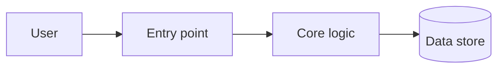

# Architecture

<!-- Explain how the system works so a newcomer can predict where a change belongs and what it might break. Explain relationships and reasons; for fields, versions, signatures, and configuration values, name the file that holds them instead of copying them. -->

## The big picture

<!-- Tell the story of one typical request or command from start to finish. Then add a diagram if it helps. -->

## Parts and what they own

<!-- For each part: its job, the state it owns, where its code lives, and what it must never do. -->

## Key flows

## Failure and recovery

<!-- What can fail, what the system does about it, what the user sees, and what is safe to retry. -->

## Boundaries

<!-- Trust boundaries, external services, and the contracts that other parts or other systems rely on. -->
