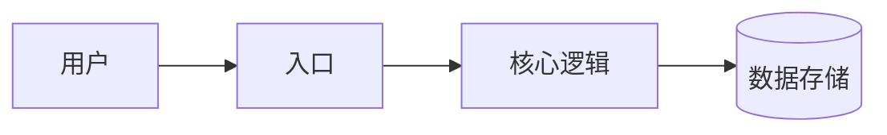

# 架构

<!-- 讲清系统怎样运转，让新来的人能判断一个改动该落在哪里、可能碰坏什么。
解释各部分的关系和原因；字段、版本号、函数签名、配置值这类细节，写明在哪个
文件里就行，不要抄过来。 -->

## 全景

<!-- 先把一次典型请求或命令从头到尾讲一遍，需要的话再配一张图。 -->

## 组成部分及其职责

<!-- 每个部分写：它负责什么、掌管哪些状态、代码在哪里、绝对不能做什么。 -->

## 关键流程

## 失败与恢复

<!-- 哪里可能出错、系统怎么应对、用户看到什么、哪些操作可以安全重试。 -->

## 边界

<!-- 信任边界、外部服务，以及其他部分或其他系统依赖的契约。 -->
